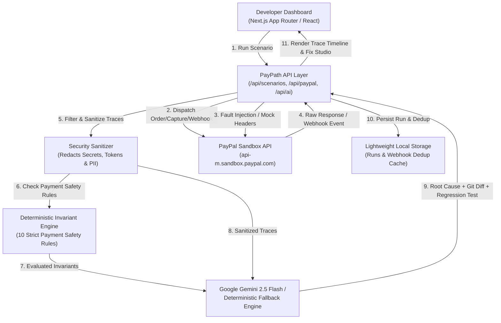

# PayPath — PayPal Payment Reliability Lab & AI Diagnostic Engine

> **Test real PayPal payment flows, expose failure-handling weaknesses, and use AI to diagnose payment integration errors and verify proposed fixes.**

[](https://developer.paypal.com)
[](https://ai.google.dev)
[](https://nextjs.org)
[](https://www.typescriptlang.org)
[](https://vitest.dev)
[](./LICENSE)

---

## 🎯 Executive Summary & Problem Statement

Most e-commerce and SaaS checkouts appear to work perfectly during a happy-path demo. But when unexpected production chaos hits, integrations fail in catastrophic ways:

1. **Decline Swallowing:** A card is declined by the issuer (`INSTRUMENT_DECLINED`), but careless error-handling swallows the 422 HTTP status and erroneously displays an order confirmation page to the buyer—shipping goods without getting paid.
2. **Blind Retries & Double Debits:** A capture request experiences a network socket drop or 504 Gateway Timeout. The backend does not know if the payment went through and blindly retries `POST /capture`, triggering 422 errors or double-charging customer accounts.
3. **Webhook Duplication & Double Credits:** Payment webhooks deliver at-least-once. Delayed network retries re-deliver `PAYMENT.CAPTURE.COMPLETED`, causing naive handlers to credit accounts or extend subscriptions twice.
4. **State Machine Regressions:** An asynchronous `CHECKOUT.ORDER.APPROVED` webhook arrives late after the order has already been `COMPLETED`, reverting the order back to a pending state.
5. **Forged Webhooks:** Webhook handlers process incoming event payloads without cryptographic signature verification (`/v1/notifications/verify-webhook-signature`), leaving merchants vulnerable to spoofing.

**PayPath is not another generic AI shopping chatbot.** It is a specialized **Payment Reliability Lab & Developer Diagnostic Studio** designed to help indie developers, SaaS founders, and engineering teams reproduce, chaos-test, and harden their PayPal integrations before going to production.

---

## 🏛️ System Architecture

PayPath is built with Next.js (App Router), TypeScript, Tailwind CSS, official PayPal REST APIs, and a Google Gemini AI Diagnostic adapter.



---

## 🧪 7 Comprehensive Reliability Scenarios

| Scenario Code | Title | Category | Focus Area |
| :--- | :--- | :--- | :--- |
| **SCENARIO-A** | **Standard Checkout Flow & Capture** | `Core Flow` | Order creation with `PayPal-Request-Id`, payer approval, server-side capture, authoritative confirmation. |
| **SCENARIO-B** | **Payment Instrument Declined** | `Error Handling` | PayPal Sandbox negative testing (`INSTRUMENT_DECLINED`). Verifies UI detects card rejection without false fulfillment. |
| **SCENARIO-C** | **Uncertain Capture & Reconciliation** | `Fault Recovery` | Injected 504 Gateway Timeout. Proves state reconciliation (`GET /v2/checkout/orders/{id}`) prevents blind double retries. |
| **SCENARIO-D** | **Duplicate Webhook Delivery** | `Idempotency` | Multiple identical deliveries of `PAYMENT.CAPTURE.COMPLETED`. Verifies atomic deduplication (`event_id`). |
| **SCENARIO-E** | **Webhook Signature Verification** | `Security` | Rejects forged/tampered webhooks using PayPal's cryptographic signature verification endpoint. |
| **SCENARIO-F** | **Out-of-Order Webhooks** | `Concurrency` | Prevents late-arriving `CHECKOUT.ORDER.APPROVED` from regressing settled `COMPLETED` orders. |
| **SCENARIO-G** | **API & Config Error Diagnostics** | `API Robustness` | Tests invalid currencies (422) and authentication failures (401), ensuring zero credential leaks in logs. |

---

## 🔒 10 Deterministic Payment Invariants

Deterministic rules—not AI hallucinations—objectively decide whether a test run passes or fails:

1. **INV-001 (Monotonic State Progression):** Terminal states (`COMPLETED`, `VOIDED`, `DECLINED`) can never revert backward.
2. **INV-002 (No Blind Retry Without Reconciliation):** Network drops during capture require authoritative state query before retrying.
3. **INV-003 (Strict Decline Detection):** `INSTRUMENT_DECLINED` must immediately halt fulfillment and display a payment failure notice.
4. **INV-004 (Webhook Event Deduplication):** Identical `event_id` deliveries trigger exactly one business fulfillment.
5. **INV-005 (Webhook Signature Verification):** Cryptographic verification required prior to payload processing.
6. **INV-006 (Idempotency Header Enforcement):** All state-mutating requests must supply `PayPal-Request-Id`.
7. **INV-007 (Zero Credential Leakage):** Access tokens, client secrets, and credit card numbers are strictly redacted from traces.
8. **INV-008 (Capture Requires Buyer Approval):** An order in `CREATED` state cannot be captured without payer authorization.
9. **INV-009 (Authoritative Ledger Confirmation):** Final success requires server-side `COMPLETED` confirmation from PayPal API.
10. **INV-010 (Graceful Error Diagnostics):** All upstream API failures produce structured, typed errors with zero stack dump crashes.

---

## 🤖 AI Diagnostic Engine & Fix Studio

PayPath pairs deterministic rule checking with deep AI diagnosis:

- **Input:** Sanitized request/response traces, HTTP headers, state transitions, latency metrics, and invariant violation reports.
- **Provider:** Powered by **Google Gemini 2.5 Flash** (via the modern `@google/genai` SDK), with an automatic, transparent fallback to an offline **Deterministic Payment Rule Engine** when API keys are unconfigured.
- **Outputs:**
  1. **Concise Root-Cause Hypothesis:** Identifies the precise architectural defect.
  2. **Factual Evidence List:** Numbered citations from actual execution events.
  3. **Confidence Score:** 0–100% confidence rating.
  4. **Recommended Code Fix:** Unified Git diff syntax showing the drop-in resilient replacement.
  5. **Proposed Regression Test:** Executable TypeScript/Vitest test code.
  6. **One-Click Apply & Re-Verify:** Reruns the scenario with the resilient patch to confirm regression resolution.

---

## 🚀 Quick Start Guide

### Prerequisites
- Node.js 18+ (tested on Node v24.18)
- npm 9+

### 1. Clone & Install
```bash
git clone https://github.com/your-username/paypath.git
cd paypath
npm install
```

### 2. Configure Environment (Optional for Sandbox Mode)
```bash
cp .env.example .env.local
```
Add your credentials in `.env.local`:
```env
PAYPAL_CLIENT_ID=your_sandbox_client_id
PAYPAL_CLIENT_SECRET=your_sandbox_client_secret
PAYPAL_WEBHOOK_ID=your_webhook_id
GEMINI_API_KEY=your_gemini_api_key
```
> *Note: PayPath works straight out of the box with built-in high-fidelity fault-injection simulation and its offline expert rule engine if no keys are provided!*

### 3. Run Automated Tests
```bash
npm run test
```
All 13 automated unit and integration tests run via Vitest in under 1 second.

### 4. Start the Application
```bash
npm run build
npm run start
```
Open **[http://localhost:3000](http://localhost:3000)** in your browser.

---

## 💳 PayPal Sandbox Setup & Negative Testing

To test real negative error conditions against the live PayPal Sandbox API:

1. Log into your [PayPal Developer Dashboard](https://developer.paypal.com/dashboard/).
2. Navigate to **Testing Tools** > **Sandbox Accounts**.
3. Click the `...` menu next to your Business account > **View/Edit Account** > **Settings**.
4. Enable **Negative Testing** toggle.
5. In PayPath, select **Scenario B** or any scenario with mode set to `Real Sandbox API`. PayPath automatically supplies the official `PayPal-Mock-Response` headers:
   ```http
   PayPal-Mock-Response: {"mock_application_codes": "INSTRUMENT_DECLINED"}
   ```

---

## 📊 Verification Matrix & Truthful Claims

| Scenario | Execution Mode | Verification Status | Invariants Checked |
| :--- | :--- | :--- | :--- |
| **Scenario A** (Checkout & Capture) | `REAL SANDBOX` / `SIMULATED` | `[VERIFIED]` | INV-001, INV-006, INV-007, INV-009 |
| **Scenario B** (Decline Handling) | `REAL SANDBOX` / `SIMULATED` | `[VERIFIED]` | INV-003, INV-007, INV-010 |
| **Scenario C** (Uncertain Capture & Recon) | `LOCALLY SIMULATED FAULT` | `[VERIFIED]` | INV-001, INV-002, INV-006, INV-007 |
| **Scenario D** (Duplicate Webhooks) | `LOCALLY SIMULATED FAULT` | `[VERIFIED]` | INV-004, INV-007 |
| **Scenario E** (Signature Verification) | `REAL SANDBOX` / `SIMULATED` | `[VERIFIED]` | INV-005, INV-007 |
| **Scenario F** (Out-of-Order Webhooks) | `LOCALLY SIMULATED FAULT` | `[VERIFIED]` | INV-001, INV-007 |
| **Scenario G** (API & Config Errors) | `LOCALLY SIMULATED FAULT` | `[VERIFIED]` | INV-007, INV-010 |
| **Unit & Integration Suite** | `AUTOMATED UNIT TEST` | `[VERIFIED - 13/13 PASS]` | Invariants, Sanitizer, State Machine |

---

## 🎬 3-Minute Video Demo Script

**Total Runtime:** 2 minutes 50 seconds

| Timestamp | Screen | Narration / Action |
| :--- | :--- | :--- |
| **0:00 - 0:25** | **Dashboard Header & Problem Statement** | "Hi everyone! This is PayPath—the PayPal Payment Reliability Lab. When building PayPal checkouts, developers test the happy path and assume it works. But what happens when a card declines, webhooks duplicate, or a network drops during capture? PayPath is the chaos-testing and AI diagnostic tool built to expose and fix these edge cases." |
| **0:25 - 0:55** | **Scenario Lab — Exposing Scenario B (Decline)** | "Let's head into the Scenario Lab. We select Scenario B: Payment Instrument Declined. We run the test in vulnerable baseline mode. PayPal returns HTTP 422 with INSTRUMENT_DECLINED, but look at the outcome: FAILED! Our deterministic invariant INV-003 detected that naive checkout code swallowed the decline and misreported the order as COMPLETED." |
| **0:55 - 1:35** | **AI Diagnostic Studio & Fix Studio** | "PayPath automatically transitions into the AI Diagnostic Studio. Notice that all credentials and card data have been stripped by our security sanitizer. Google Gemini 2.5 Flash analyzes the sanitized traces, forms a root-cause hypothesis with 98% confidence, outputs the exact unified git diff, and drafts an automated regression test." |
| **1:35 - 2:05** | **One-Click Apply & Regression Verification** | "We click 'Apply Fix & Re-Verify Regression'. PayPath immediately re-executes the test with the resilient pattern. Now the final state is correctly marked DECLINED, and all deterministic invariants pass green! In the Regression Suite tab, we see the clear before-and-after audit trail." |
| **2:05 - 2:35** | **Scenario C & Webhook Idempotency** | "Next, we run Scenario C: Uncertain Capture Outcome. We simulate a 504 network timeout. Rather than blindly retrying, PayPath demonstrates authoritative state reconciliation via GET /v2/checkout/orders. We can also open our Webhook Simulator to test duplicate delivery and watch event deduplication prevent double-fulfillment." |
| **2:35 - 2:50** | **Conclusion & Impact** | "PayPath provides automated unit tests, real PayPal Sandbox integration, and AI diagnostics. It transforms brittle checkouts into battle-tested payment systems. Thank you!" |

---

## 📋 Devpost Submission Checklist

- [x] **Project Name:** PayPath
- [x] **Tagline:** Test real PayPal payment flows, expose failure-handling weaknesses, and use AI to diagnose payment integration errors and verify proposed fixes.
- [x] **Category:** PayPal Developer Platform + AI Developer Tooling & Payment Reliability
- [x] **PayPal Integration:** Orders v2 REST API, OAuth2 token management, `PayPal-Request-Id` idempotency, `PayPal-Mock-Response` negative testing, Authoritative state reconciliation (`GET /orders/{id}`), Webhook signature verification (`/v1/notifications/verify-webhook-signature`).
- [x] **AI Integration:** Google Gemini 2.5 Flash via `@google/genai` analyzing sanitized payment traces, synthesizing root-cause hypotheses, generating Git diffs, and proposing regression tests, with transparent deterministic fallback.
- [x] **Working Prototype:** Fully functional Next.js dashboard running at `http://localhost:3000`.
- [x] **Automated Tests:** 13 unit and integration tests passing (`vitest`).
- [x] **Public Code Repository:** Clean git repository with MIT license and `.env.example`.
- [x] **Zero Credential Leakage:** Automated recursive sanitizer redacting tokens, keys, and PII.
- [x] **Video Demo Script:** Comprehensive sub-3-minute walkthrough included.

---

## 📄 License

This project is licensed under the [MIT License](./LICENSE).
