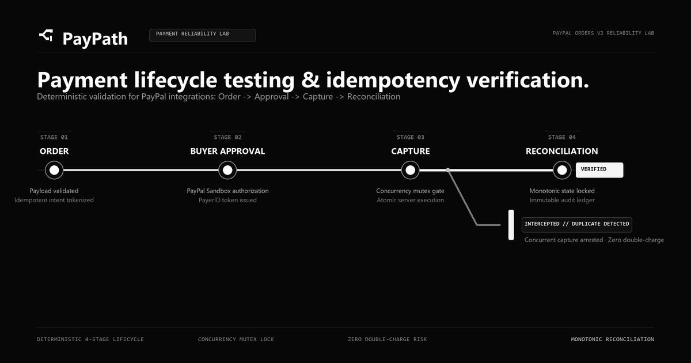
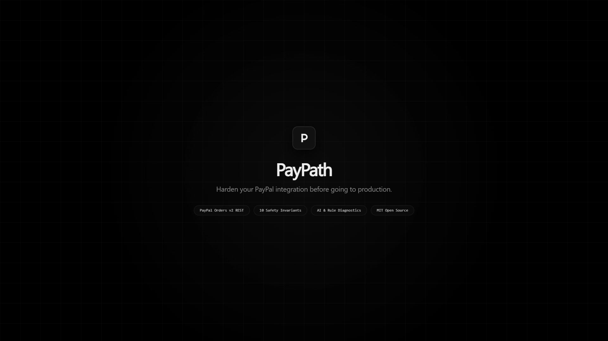
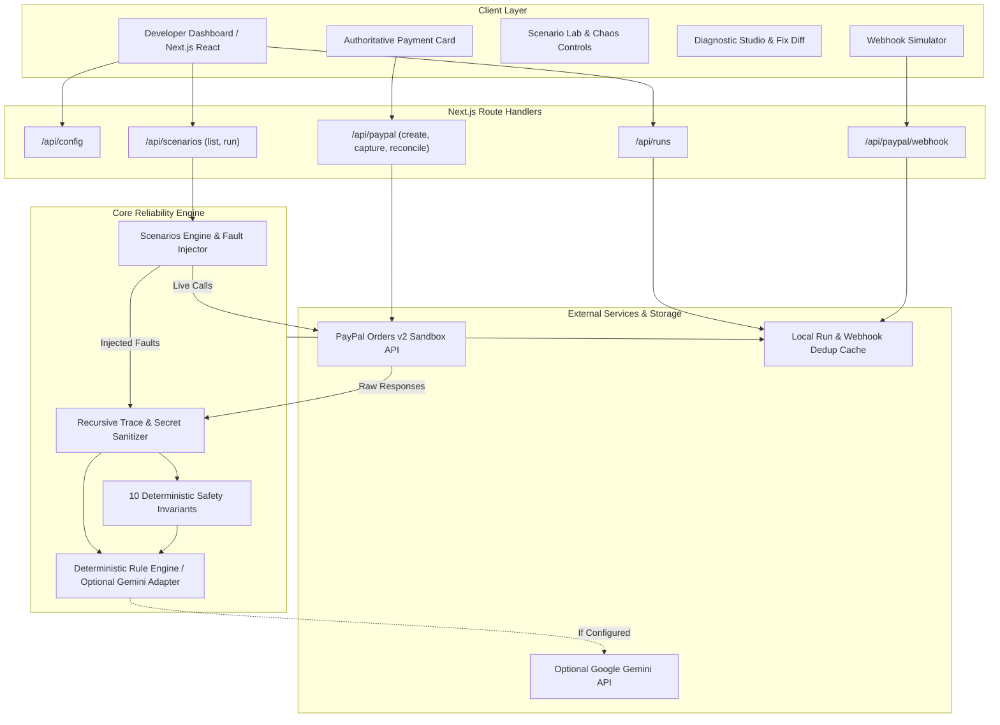

# PayPath — Payment Reliability Lab



A developer testing harness and diagnostic workbench for PayPal checkout integrations. PayPath reproduces edge-case payment failures, injects chaos conditions, verifies transactions against 10 deterministic safety invariants, and generates resilient code fixes.

`Next.js 16` | `TypeScript 5` | `Tailwind CSS v4` | `PayPal Orders v2 REST` | `Vitest 5` | `Deterministic Rule Engine`

---

## Table of Contents

- [Product Walkthrough](#product-walkthrough)
- [Product Screenshots](#product-screenshots)
- [Problem and Solution](#problem-and-solution)
- [Key Features](#key-features)
- [Architecture](#architecture)
- [Technology Stack](#technology-stack)
- [Setup and Local Development](#setup-and-local-development)
- [Testing and Verification](#testing-and-verification)
- [Security and Limitations](#security-and-limitations)
- [License and Contribution](#license-and-contribution)

---

## Product Walkthrough

A 23-second product launch video provides an overview of the PayPath testing workflow, including fault injection, invariant violation detection, and safe state reconciliation.

[](media/paypath-product-launch.mp4)

*Note: GitHub does not support inline playback of local video files. Click the preview above to view or download the high-resolution 23-second launch video (`media/paypath-product-launch.mp4`). This video is a product teaser and does not replace the full technical demonstration.*

---

## Product Screenshots

The following screenshots are captured directly from the running PayPath application at 1920x1080 resolution in dark mode:

### 1. Main Dashboard and Authoritative Payment Overview

*Main dashboard showing runtime environment connectivity, active deterministic diagnostic engine mode, persisted settlement details with masked transaction identifiers, and the primary navigation structure.*

### 2. Scenario Lab and Chaos Testing Controls

*Scenario Lab interface showing Scenario C (Uncertain Capture Outcome and State Reconciliation) selected in Fault Injection mode under the Unfixed Baseline state, with execution outcome reporting a failed run.*

### 3. Failure Detection and Deterministic Invariant Violation

*Failure analysis panel showing a simulated 504 Gateway Timeout during capture, triggering invariant INV-002 (No Blind Retry Without Reconciliation) at Critical severity, attributed to the deterministic rule engine.*

### 4. Diagnostic Studio and Proposed Code Diff

*Diagnostic Studio displaying the root-cause hypothesis, observed factual trace evidence, and a unified Git diff for `src/services/paypal-reconciliation.ts` implementing authoritative ground-truth order reconciliation.*

### 5. Regression Testing and Execution History

*Regression suite audit trail contrasting an initial unfixed failed execution against a subsequent completed execution that passed all safety invariants with the resilience fix applied.*

### 6. PayPal Webhook Simulator and Deduplication

*Interactive webhook simulator dispatching duplicate `PAYMENT.CAPTURE.COMPLETED` events, validating that the handler recognizes identical event identifiers and returns an acknowledged skipped action.*

---

## Problem and Solution

E-commerce checkouts often function during happy-path integration tests, but encounter critical failures under production edge cases:

1. **Blind Retries on Network Timeouts:** When a client-to-server connection drops or a 504 Gateway Timeout occurs during capture, the client cannot confirm whether the charge succeeded. Blindly retrying the capture request risks duplicate debits or upstream 422 errors.
   - *PayPath Safeguard:* Enforces invariant `INV-002`. The checkout must query `GET /v2/checkout/orders/{id}` to reconcile state before attempting recovery actions.

2. **Swallowed Card Declines:** Upstream issuers reject cards with `INSTRUMENT_DECLINED`. Naive client implementations that fail to inspect the HTTP 422 status and response payload may misreport success, causing merchants to fulfill unpaid orders.
   - *PayPath Safeguard:* Enforces invariant `INV-003`. All capture responses must be validated for explicit `COMPLETED` status prior to downstream fulfillment.

3. **Duplicate Webhook Delivery:** Payment webhooks operate under at-least-once delivery guarantees. Delayed retries can deliver identical `PAYMENT.CAPTURE.COMPLETED` payloads multiple times.
   - *PayPath Safeguard:* Enforces invariant `INV-004`. The webhook receiver checks event identifiers against an atomic store, returning `ACKNOWLEDGED_DUPLICATE_SKIPPED` on replays.

4. **Out-of-Order State Regressions:** Network latencies can cause an earlier `CHECKOUT.ORDER.APPROVED` webhook to arrive after an authoritative `PAYMENT.CAPTURE.COMPLETED` event.
   - *PayPath Safeguard:* Enforces invariant `INV-001`. Payment states transition monotonically; terminal states (`COMPLETED`, `VOIDED`, `DECLINED`) cannot be overwritten by pending events.

---

## Key Features

- **PayPal Orders v2 REST Integration:** Functional endpoints for order creation (`/api/paypal/create-order`), order capture (`/api/paypal/capture-order`), and order reconciliation (`/api/paypal/reconcile`) communicating with the PayPal Sandbox.
- **Authoritative State Reconciliation:** Ground-truth validation querying PayPal order details directly to determine true transaction status after ambiguous network outcomes.
- **10 Deterministic Safety Invariants:** Strict programmatic rules evaluating every execution trace:
  - `INV-001`: Monotonic State Progression
  - `INV-002`: No Blind Retry Without Reconciliation
  - `INV-003`: Strict Decline Detection
  - `INV-004`: Webhook Event Deduplication
  - `INV-005`: Webhook Signature Verification
  - `INV-006`: Idempotency Header Enforcement
  - `INV-007`: Zero Credential Leakage
  - `INV-008`: Capture Requires Buyer Approval
  - `INV-009`: Authoritative Ledger Confirmation
  - `INV-010`: Graceful Error Diagnostics
- **7 Reliability Testing Scenarios:** Catalog spanning core flows, error handling, network drops, idempotency, signature validation, out-of-order concurrency, and API robustness.
- **Fault-Injection Engine:** Controlled local simulation of 504 Gateway Timeouts, network socket drops, and mock response headers (`PayPal-Mock-Response`).
- **Trace Sanitization:** Recursive credential redactor that scrubs client secrets, OAuth bearer tokens, authorization headers, and payment card numbers before storage or presentation.
- **Diagnostic Studio:** Automated root-cause analysis based on trace anomalies and invariant violations, producing unified Git diffs and regression test drafts.
- **Webhook Simulator:** In-app testing modal for dispatching test events, validating duplicate event replay handling, and testing cryptographic signature verification.
- **Local Run Persistence:** Structured file storage under `.paypath-data/` tracking run histories, invariant audit trails, and payment confirmations.

*Distinction note: Live PayPal Sandbox calls execute against `api-m.sandbox.paypal.com`. Fault scenarios (such as simulated 504 timeouts) inject mock network behaviors locally to safely test error handlers. Proposed code fixes are formatted diffs designed for developer review.*

---

## Architecture

The following diagram illustrates the relationship between the dashboard, API routes, reliability engines, and storage components:



---

## Technology Stack

| Layer | Component | Version / Specification |
| :--- | :--- | :--- |
| **Framework** | Next.js (App Router, Turbopack) | `16.4.2` |
| **Language** | TypeScript | `5.0+` |
| **UI Library** | React | `19.3.0` |
| **Styling** | Tailwind CSS | `4.0` |
| **Icons** | Lucide React | `1.59.0` |
| **Testing** | Vitest | `5.0.5` |
| **Payment API** | PayPal Orders v2 REST API | Sandbox environment |
| **AI Integration** | Google GenAI SDK (`@google/genai`) | `^2.30.0` (Optional adapter) |

### AI Provider Status and Disclosure

The runtime operates with the **PayPath Deterministic Payment Rule Engine** as its active diagnostic provider. When no `GEMINI_API_KEY` is supplied, all invariant checks, root-cause analyses, Git diffs, and test recommendations are generated deterministically by the offline rule engine.

The codebase includes an optional Google Gemini adapter (`src/lib/ai-diagnostic-engine.ts`) supporting `gemini-2.5-flash`. To activate live Gemini reasoning, supply a valid API key in `.env.local`. When unconfigured, the application runs fully offline without external AI dependencies.

---

## Setup and Local Development

### Prerequisites

- Node.js `18.0.0` or higher (verified on Node.js v24)
- npm `9.0.0` or higher
- Optional: A PayPal Developer Sandbox account

### 1. Clone the Repository

```bash
git clone https://github.com/your-username/paypath.git
cd paypath
```

### 2. Install Dependencies

```bash
npm install
```

### 3. Configure Environment Variables

Create a local environment file from the template:

```bash
cp .env.example .env.local
```

Populate `.env.local` with your configuration:

```env
# PayPal Sandbox Credentials (Required for live Sandbox API calls)
PAYPAL_CLIENT_ID=your_paypal_sandbox_client_id_here
PAYPAL_CLIENT_SECRET=your_paypal_sandbox_client_secret_here
PAYPAL_WEBHOOK_ID=your_paypal_webhook_id_here
PAYPAL_ENV=sandbox

# AI Diagnostics (Optional: Leave blank to use Deterministic Rule Engine)
GEMINI_API_KEY=your_gemini_api_key_here
AI_MODEL=gemini-2.5-flash

# Application Runtime
PORT=3000
NODE_ENV=development
NEXT_PUBLIC_APP_URL=http://localhost:3000
```

*Important: PayPath is designed strictly for testing in the PayPal Sandbox. It does not initiate or authorize real-money production transactions.*

### 4. Run the Development Server

```bash
npm run dev
```

Open [http://localhost:3000](http://localhost:3000) in your browser.

### 5. Run the Automated Tests

```bash
npm run test
```

### 6. Build and Start the Production Bundle

```bash
npm run build
npm run start
```

---

## Testing and Verification

The following verification results have been confirmed in the current environment:

| Test Scope | Target | Result | Evidence |
| :--- | :--- | :--- | :--- |
| **Unit & Integration Suite** | `tests/invariants.test.ts` | 5 passed | Evaluates decline, double-capture, and monotonic invariants |
| **Unit & Integration Suite** | `tests/sanitization.test.ts` | 3 passed | Verifies scrubbing of tokens, secrets, and auth headers |
| **Unit & Integration Suite** | `tests/scenarios.test.ts` | 5 passed | Validates scenario catalog, invariants mapping, and defaults |
| **Production Build** | `next build` | 0 errors | All 19 static and dynamic routes compiled with Turbopack |
| **Sandbox Connectivity** | PayPal Orders v2 API | Verified | Token retrieval, order creation, capture, and reconciliation |
| **Fault Injection** | Scenario C (504 Timeout) | Verified | Simulates gateway timeout, detects INV-002, presents diff |
| **Webhook Deduplication** | `/api/paypal/webhook` | Verified | Duplicate event ID yields `ACKNOWLEDGED_DUPLICATE_SKIPPED` |

*Total automated unit tests: 13 passed out of 13 tests (execution time: ~1.4 seconds).*

---

## Security and Limitations

### Security Architecture

- **Server-Side Secret Isolation:** PayPal client secrets and API keys are only accessed inside Next.js server-side route handlers. They are never exported in client bundles or public environment variables.
- **Recursive Credential Scrubbing:** Request headers, response bodies, and error stacks pass through `src/lib/sanitization.ts` before being written to disk, sent to client components, or transmitted to an optional AI provider.
- **Identifier Masking:** Public-facing dashboard panels mask transaction identifiers (for example, `3JL9••••••••362V`).
- **Cryptographic Webhook Verification:** The webhook endpoint verifies event integrity via PayPal's `/v1/notifications/verify-webhook-signature` API when a webhook ID is configured.

### Known Limitations

- **Sandbox Scope:** PayPath targets PayPal Sandbox APIs. Sandbox latency, availability, and error responses can differ from production behavior.
- **Simulated Faults:** Network timeouts (such as 504 Gateway Timeout) and card declines in fault mode are controlled local simulations designed to test application resiliency without requiring live network degradation.
- **Local Webhook Receiver:** In local development, receiving live webhooks dispatched from PayPal requires a public forwarding tunnel (such as ngrok). The in-app Webhook Simulator provides end-to-end event testing locally without external tunnels.

---

## License and Contribution

### License

This project is licensed under the [MIT License](LICENSE).

### Contributing

1. Fork the repository.
2. Create a feature branch: `git checkout -b feature/reliability-scenario`.
3. Ensure automated tests pass: `npm run test`.
4. Verify the production build: `npm run build`.
5. Submit a pull request with a description of the reliability scenario or invariant addition.
