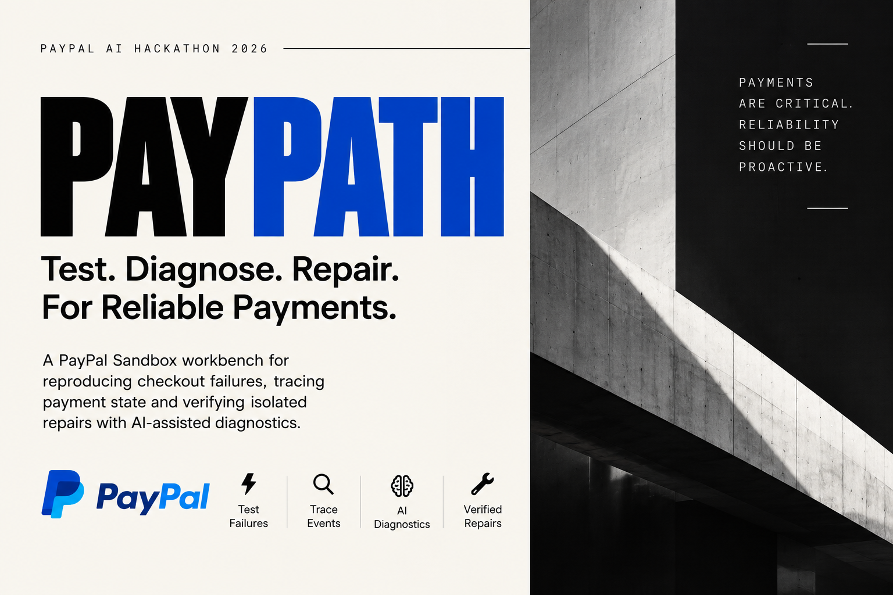

[](https://nextjs.org/)
[](https://react.dev/)
[](https://www.typescriptlang.org/)
[](https://tailwindcss.com/)
[](https://developer.paypal.com/docs/api/orders/v2/)
[](#key-features)
[](#key-features)
[](https://vitest.dev/)
[](LICENSE)

PayPath is an open-source payment reliability harness and autonomous repair agent for PayPal Orders v2 integrations. It intercepts checkout failure scenarios, validates monotonic payment safety invariants, diagnoses root causes, and synthesizes verified AST code patches inside isolated Git worktrees.

---

## Table of Contents

- [Demonstration & Video Walkthrough](#demonstration--video-walkthrough)
- [Product Screenshots](#product-screenshots)
- [Problem and Solution](#problem-and-solution)
- [Key Features](#key-features)
- [Architecture](#architecture)
- [Technology Stack](#technology-stack)
- [Setup and Local Development](#setup-and-local-development)
- [Testing and Verification](#testing-and-verification)
- [Security and Limitations](#security-and-limitations)
- [License and Contribution](#license-and-contribution)


---

## Demonstration & Video Walkthrough

### PayPath — AI-Powered Payment Reliability & Autonomous Repair Demo (2:41)

[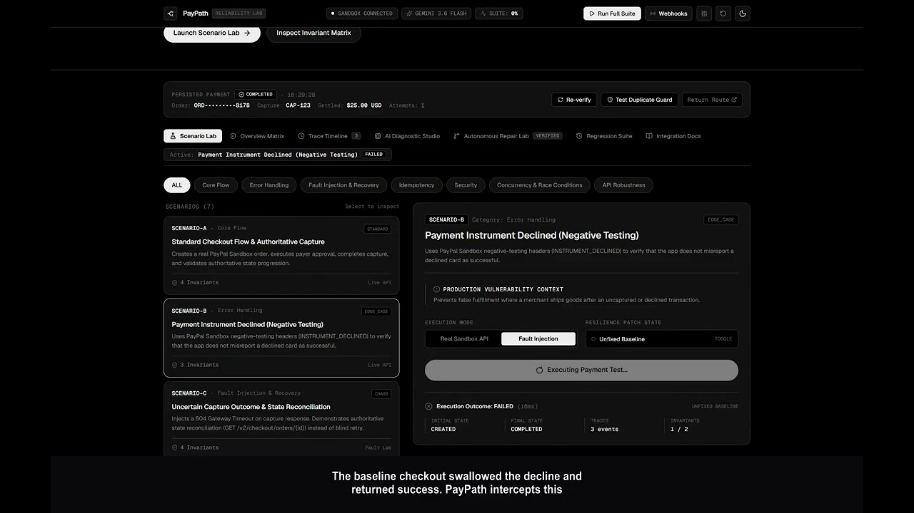](https://youtu.be/LPS2AAMqVgk)

> 📺 **[Watch Full HD Walkthrough on YouTube (2:41) → https://youtu.be/LPS2AAMqVgk](https://youtu.be/LPS2AAMqVgk)**  
> *A live developer walkthrough demonstrating checkout failure interception, deterministic invariant violation, structured root-cause analysis, ephemeral Git worktree repair, and human-in-the-loop sign-off.*

---

## Product Screenshots

The following screenshots are captured directly from the running PayPath application at 1920x1080 resolution in dark mode:

### 1. Main Dashboard and Authoritative Payment Overview
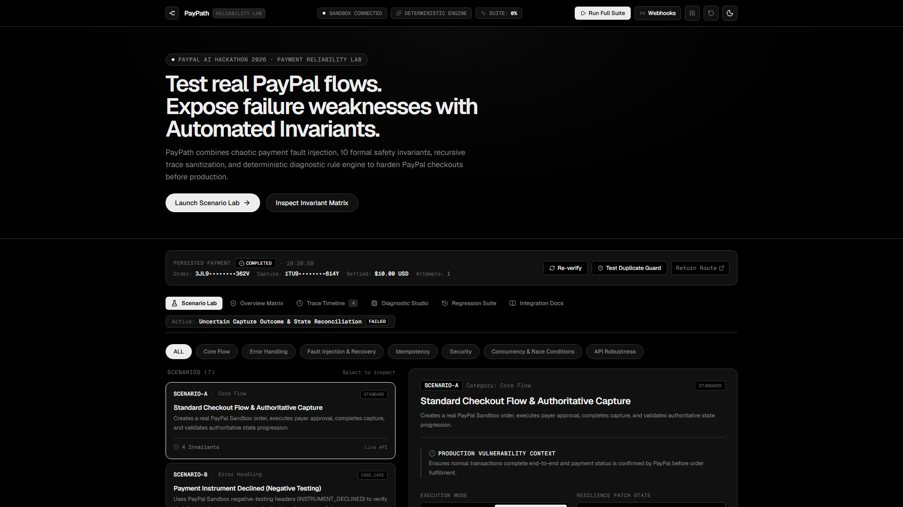
*Main dashboard showing runtime environment connectivity, active deterministic diagnostic engine mode, persisted settlement details with masked transaction identifiers, and the primary navigation structure.*

### 2. Scenario Lab and Chaos Testing Controls
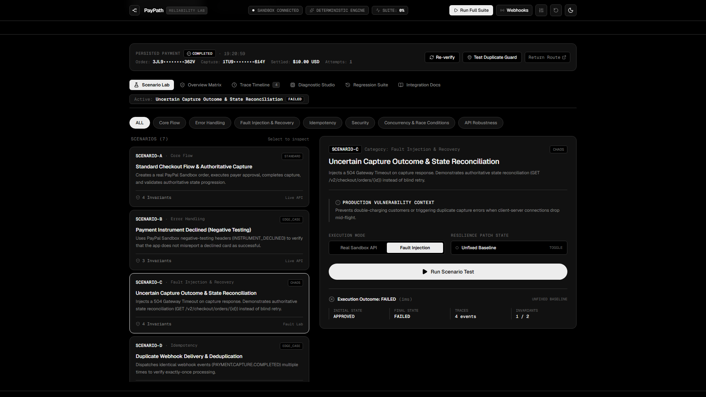
*Scenario Lab interface showing Scenario C (Uncertain Capture Outcome and State Reconciliation) selected in Fault Injection mode under the Unfixed Baseline state, with execution outcome reporting a failed run.*

### 3. Failure Detection and Deterministic Invariant Violation
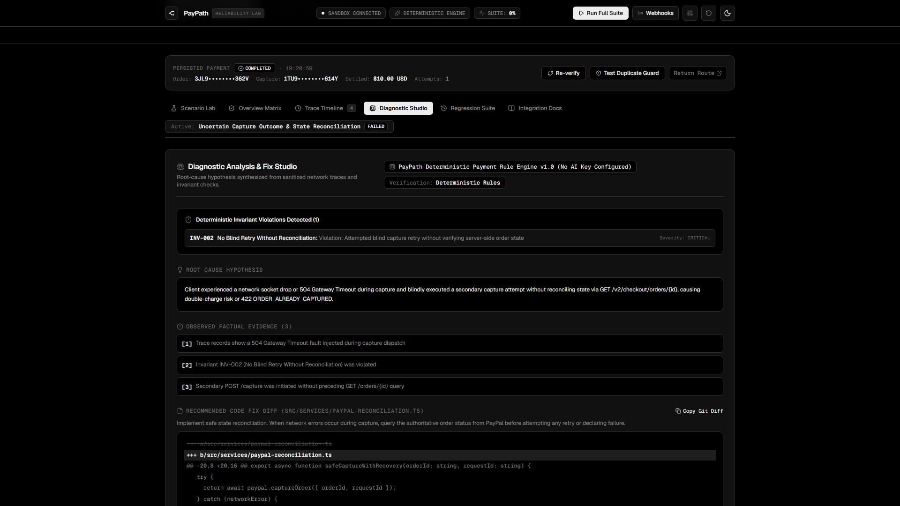
*Failure analysis panel showing a simulated 504 Gateway Timeout during capture, triggering invariant INV-002 (No Blind Retry Without Reconciliation) at Critical severity, attributed to the deterministic rule engine.*

### 4. Diagnostic Studio and Proposed Code Diff
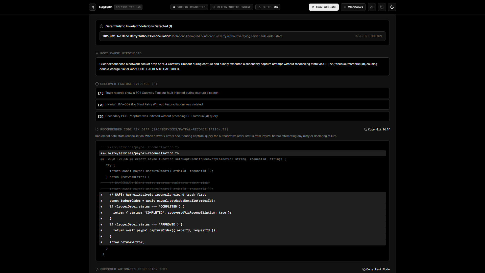
*Diagnostic Studio displaying the root-cause hypothesis, observed factual trace evidence, and a unified Git diff for `src/services/paypal-reconciliation.ts` implementing authoritative ground-truth order reconciliation.*

### 5. Regression Testing and Execution History
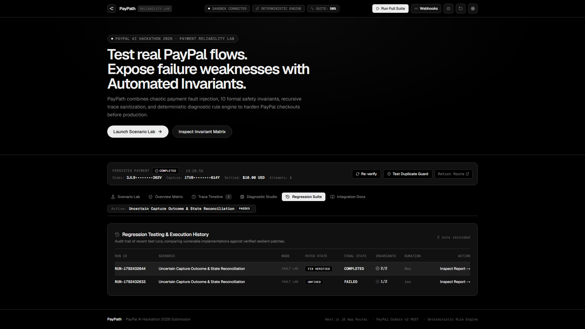
*Regression suite audit trail contrasting an initial unfixed failed execution against a subsequent completed execution that passed all safety invariants with the resilience fix applied.*

### 6. PayPal Webhook Simulator and Deduplication
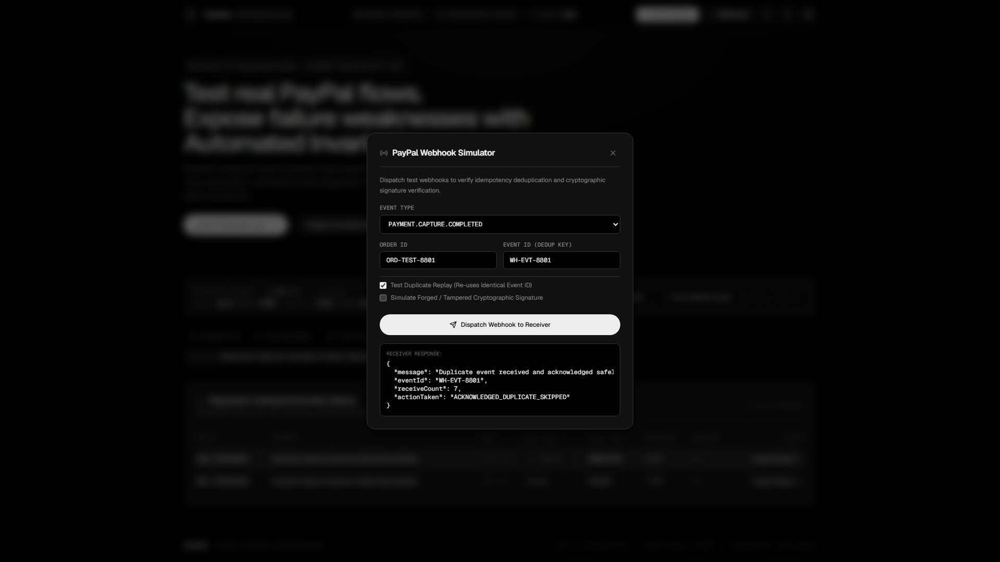
*Interactive webhook simulator dispatching duplicate `PAYMENT.CAPTURE.COMPLETED` events, validating that the handler recognizes identical event identifiers and returns an acknowledged skipped action.*

### 7. Autonomous Repair Lab and Isolated Worktree Diff
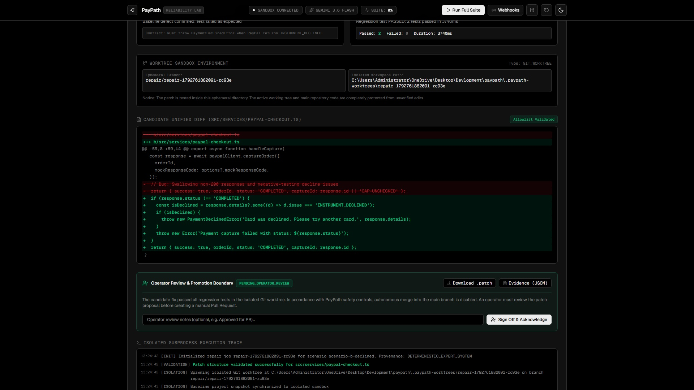
*Autonomous Repair Lab displaying the synthesized candidate patch for `src/services/paypal-checkout.ts` inside an isolated Git worktree sandbox, complete with allowlist validation, regression test verification, and the operator review sign-off boundary.*

### 8. Sanitized Incident Timeline and Telemetry Export
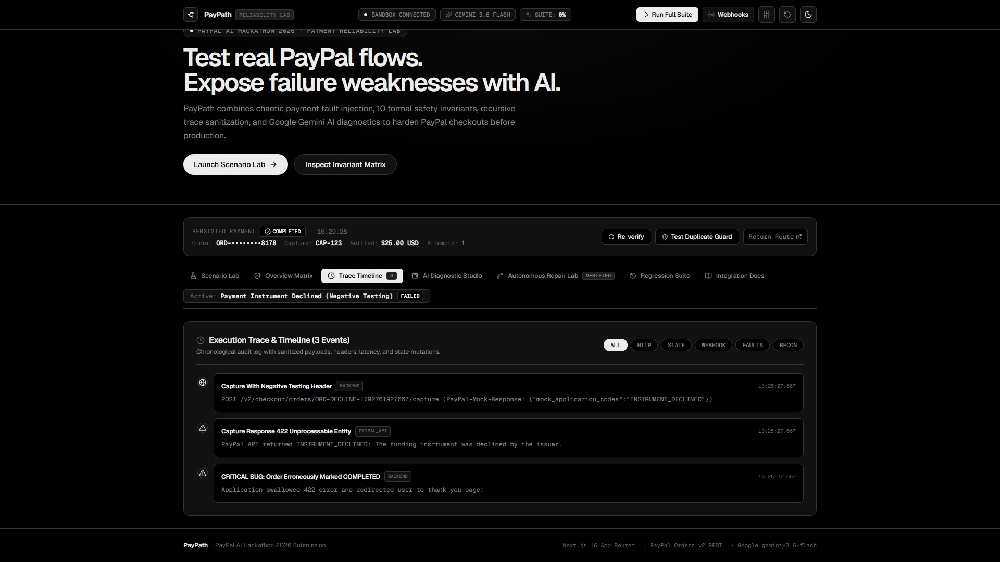
*Sanitized execution trace timeline detailing intercepted HTTP requests, negative-testing simulation headers, and state transitions with sensitive OAuth tokens, card details, and credentials recursively redacted for audit compliance.*

---

## Problem and Solution

When engineering PayPal checkout integrations, standard happy-path tests against the PayPal Orders v2 Sandbox only exercise optimal conditions. Real-world payment systems frequently encounter network drops, upstream gateway timeouts, issuer card declines, and duplicated or out-of-order webhook deliveries. Without dedicated payment failure testing and state reconciliation, applications risk silent transaction failures or duplicate captures:

1. **Blind Retries on Network Timeouts (Idempotency and Double-Capture Risk):** When a client-to-server connection drops or a 504 Gateway Timeout occurs during capture, the client cannot confirm whether the charge succeeded. Blindly retrying the capture request risks duplicate debits or upstream 422 errors.
   - *PayPath Safeguard:* Enforces invariant `INV-002` (No Blind Retry Without Reconciliation) and `INV-006` (Idempotency Header Enforcement). The checkout must query `GET /v2/checkout/orders/{id}` to reconcile state before attempting recovery actions.

2. **Swallowed Card Declines:** Upstream issuers reject cards with `INSTRUMENT_DECLINED`. Naive client implementations that fail to inspect the HTTP 422 status and response payload may misreport success, causing merchants to fulfill unpaid orders.
   - *PayPath Safeguard:* Enforces invariant `INV-003` (Strict Decline Detection). All capture responses must be validated for explicit `COMPLETED` status prior to downstream fulfillment.

3. **Duplicate Webhook Delivery:** Payment webhooks operate under at-least-once delivery guarantees. Delayed retries can deliver identical `PAYMENT.CAPTURE.COMPLETED` payloads multiple times, leading to duplicate fulfillment if not handled idempotently.
   - *PayPath Safeguard:* Enforces invariant `INV-004` (Webhook Event Deduplication) and `INV-005` (Webhook Signature Verification). The webhook receiver checks event identifiers against an atomic store, returning `ACKNOWLEDGED_DUPLICATE_SKIPPED` on replays.

4. **Out-of-Order State Regressions:** Network latencies can cause an earlier `CHECKOUT.ORDER.APPROVED` webhook to arrive after an authoritative `PAYMENT.CAPTURE.COMPLETED` event.
   - *PayPath Safeguard:* Enforces invariant `INV-001` (Monotonic State Progression). Payment states transition monotonically; terminal states (`COMPLETED`, `VOIDED`, `DECLINED`) cannot be overwritten by pending events.

---

## Key Features

- **PayPal Orders v2 REST Integration:** Functional endpoints for order creation (`/api/paypal/create-order`), order capture (`/api/paypal/capture-order`), and order reconciliation (`/api/paypal/reconcile`) communicating with the PayPal Sandbox.
- **Authoritative State Reconciliation:** Ground-truth validation querying PayPal order details directly to determine true transaction status after ambiguous network outcomes.
- **10 Deterministic Safety Invariants:** Strict programmatic rules evaluating every execution trace:
  - `INV-001`: Monotonic State Progression
  - `INV-002`: No Blind Retry Without Reconciliation
  - `INV-003`: Strict Decline Detection
  - `INV-004`: Webhook Event Deduplication
  - `INV-005`: Webhook Signature Verification
  - `INV-006`: Idempotency Header Enforcement
  - `INV-007`: Zero Credential Leakage
  - `INV-008`: Capture Requires Buyer Approval
  - `INV-009`: Authoritative Ledger Confirmation
  - `INV-010`: Graceful Error Diagnostics
- **7 Reliability Testing Scenarios:** Catalog spanning core flows, error handling, network drops, idempotency, signature validation, out-of-order concurrency, and API robustness.
- **Fault-Injection Engine:** Controlled local simulation of 504 Gateway Timeouts, network socket drops, and mock response headers (`PayPal-Mock-Response`).
- **Trace Sanitization:** Recursive credential redactor that scrubs client secrets, OAuth bearer tokens, authorization headers, and payment card numbers before storage or presentation.
- **Diagnostic Studio:** Automated root-cause analysis based on trace anomalies and invariant violations, producing unified Git diffs and regression test drafts.
- **Webhook Simulator:** In-app testing modal for dispatching test events, validating duplicate event replay handling, and testing cryptographic signature verification.
- **Interactive Execution Flow Graph:** Real-time visual state machine rendering the full payment lifecycle, active invariant gates, and failure interception boundaries.
- **Autonomous Repair Lab:** Ephemeral Git worktree isolation for generating, AST-validating, and testing resilience code patches before applying them.
- **Operator Review Gate:** Human-in-the-loop safety modal requiring manual developer approval and sign-off before patch application or regression deployment.
- **Sanitized Incident Telemetry & Export:** Structured JSON incident bundles with recursive secret scrubbing for postmortem auditing and compliance.
- **Local Run Persistence:** Structured file storage under `.paypath-data/` tracking run histories, invariant audit trails, and payment confirmations.

*Implementation Note: Live PayPal Sandbox requests communicate directly with `api-m.sandbox.paypal.com`. Payment failure conditions (such as 504 Gateway Timeouts or network drops) are simulated locally through controlled fault injection to test checkout error handlers safely. PayPath is a testing harness, not a production payment gateway or processor.*

---

## Architecture

The following diagram illustrates the relationship between the dashboard, API routes, reliability engines, and storage components:

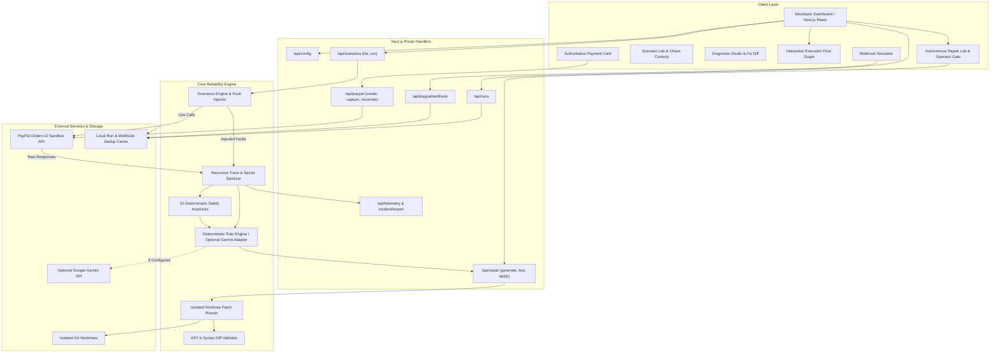

---

## Technology Stack

The PayPath testing harness is built on a type-safe full-stack TypeScript architecture:

| Layer | Component | Version / Specification | Purpose |
| :--- | :--- | :--- | :--- |
| **Framework** | Next.js (App Router, Turbopack) | `16.4.2` | Full-stack server routes, API endpoints, and reactive developer UI |
| **Language** | TypeScript | `5.0+` | End-to-end static typing for order payloads, events, and invariant rules |
| **UI Library** | React | `19.3.0` | Reactive state management, testing controls, and telemetry rendering |
| **Styling** | Tailwind CSS | `4.0` | High-density dark monochrome developer workbench design system |
| **Icons** | Lucide React | `1.59.0` | Diagnostic and status iconography |
| **Testing** | Vitest | `5.0.5` | Fast unit and integration test runner for invariant validation |
| **Payment API** | PayPal Orders v2 REST API | Sandbox environment | Live order creation, capture, and authoritative reconciliation |
| **AI Integration** | Google GenAI SDK (`@google/genai`) | `^2.30.0` (Optional adapter) | Optional reasoning adapter for offline or experimental use |

### Deterministic Rule Engine and AI Provider Disclosure

PayPath operates with the **Deterministic Payment Rule Engine** as its active, primary diagnostic provider. Invariant evaluation, root-cause diagnostics, code diff recommendations, and regression testing checks are generated entirely deterministically by local rule sets without requiring any external AI provider or API keys.

While the codebase includes an optional Google Gemini adapter (`src/lib/ai-diagnostic-engine.ts`) supporting `gemini-2.5-flash`, it is disabled by default (`provider: none`). No AI provider is active in the standard testing environment, ensuring deterministic, reproducible test results.

---

## Setup and Local Development

### Prerequisites

- Node.js `18.0.0` or higher (verified on Node.js v24)
- npm `9.0.0` or higher
- Optional: A PayPal Developer Sandbox account

### 1. Clone the Repository

```bash
git clone https://github.com/Kurosyss/paypath.git
cd paypath
```

### 2. Install Dependencies

```bash
npm install
```

### 3. Configure Environment Variables

Create a local environment file from the template:

```bash
cp .env.example .env.local
```

Populate `.env.local` with your configuration:

```env
# PayPal Sandbox Credentials (Required for live Sandbox API calls)
PAYPAL_CLIENT_ID=your_paypal_sandbox_client_id_here
PAYPAL_CLIENT_SECRET=your_paypal_sandbox_client_secret_here
PAYPAL_WEBHOOK_ID=your_paypal_webhook_id_here
PAYPAL_ENV=sandbox

# AI Diagnostics (Optional: Leave blank to use Deterministic Rule Engine)
GEMINI_API_KEY=your_gemini_api_key_here
AI_MODEL=gemini-2.5-flash

# Application Runtime
PORT=3000
NODE_ENV=development
NEXT_PUBLIC_APP_URL=http://localhost:3000
```

*Important: PayPath is designed strictly for testing in the PayPal Sandbox. It does not initiate or authorize real-money production transactions.*

### 4. Run the Development Server

```bash
npm run dev
```

Open [http://localhost:3000](http://localhost:3000) in your browser.

### 5. Run the Automated Tests

```bash
npm run test
```

### 6. Build and Start the Production Bundle

```bash
npm run build
npm run start
```

---

## Testing and Verification

The following verification results have been confirmed in the current environment:

| Test Scope | Target | Result | Evidence |
| :--- | :--- | :--- | :--- |
| **Unit & Integration Suite** | `tests/invariants.test.ts` | 5 passed | Evaluates decline, double-capture, and monotonic invariants |
| **Unit & Integration Suite** | `tests/sanitization.test.ts` | 3 passed | Verifies scrubbing of tokens, secrets, and auth headers |
| **Unit & Integration Suite** | `tests/scenarios.test.ts` | 5 passed | Validates scenario catalog, invariants mapping, and defaults |
| **Production Build** | `next build` | 0 errors | All 19 static and dynamic routes compiled with Turbopack |
| **Sandbox Connectivity** | PayPal Orders v2 API | Verified | Token retrieval, order creation, capture, and reconciliation |
| **Fault Injection** | Scenario C (504 Timeout) | Verified | Simulates gateway timeout, detects INV-002, presents diff |
| **Webhook Deduplication** | `/api/paypal/webhook` | Verified | Duplicate event ID yields `ACKNOWLEDGED_DUPLICATE_SKIPPED` |

*Total automated unit tests: 13 passed out of 13 tests (execution time: ~1.4 seconds).*

---

## Security and Limitations

### Security Architecture

- **Server-Side Secret Isolation:** PayPal client secrets and API keys are only accessed inside Next.js server-side route handlers. They are never exported in client bundles or public environment variables.
- **Recursive Credential Scrubbing:** Request headers, response bodies, and error stacks pass through `src/lib/sanitization.ts` before being written to disk, sent to client components, or transmitted to an optional AI provider.
- **Identifier Masking:** Public-facing dashboard panels mask transaction identifiers (for example, `3JL9••••••••362V`).
- **Cryptographic Webhook Verification:** The webhook endpoint verifies event integrity via PayPal's `/v1/notifications/verify-webhook-signature` API when a webhook ID is configured.

### Known Limitations

- **Sandbox Scope:** PayPath targets PayPal Sandbox APIs (`api-m.sandbox.paypal.com`). Sandbox latency, availability, and error responses can differ from production behavior.
- **Simulated Faults:** Network timeouts (such as 504 Gateway Timeout) and card declines in fault mode are controlled local simulations designed to test application resiliency without requiring live network degradation.
- **Non-Production Testing Scope:** PayPath is strictly an open-source developer testing harness and diagnostic workbench. It is not a production payment processor, merchant gateway, or commercial billing service, and live production PayPal credentials must never be configured.
- **Local Webhook Receiver:** In local development, receiving live webhooks dispatched from PayPal requires a public forwarding tunnel (such as ngrok). The in-app Webhook Simulator provides end-to-end event testing locally without external tunnels.

---

## License and Contribution

### License

This project is licensed under the [MIT License](LICENSE).

### Contributing

1. Fork the repository.
2. Create a feature branch: `git checkout -b feature/reliability-scenario`.
3. Ensure automated tests pass: `npm run test`.
4. Verify the production build: `npm run build`.
5. Submit a pull request with a description of the reliability scenario or invariant addition.
